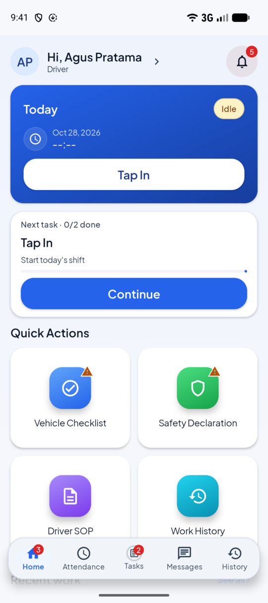
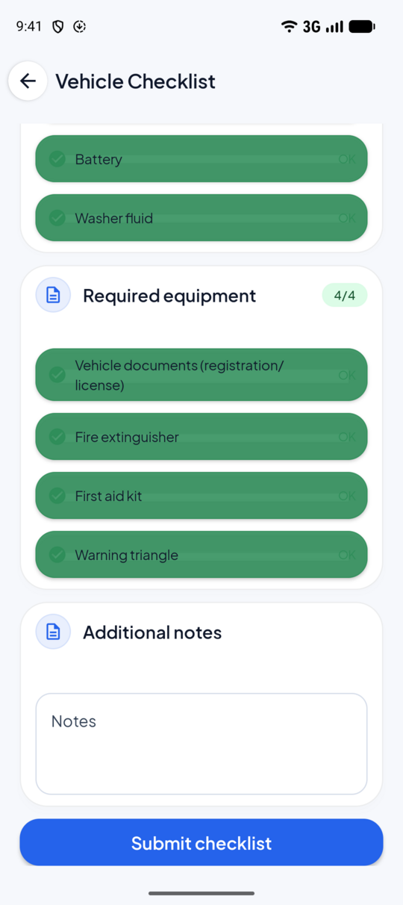
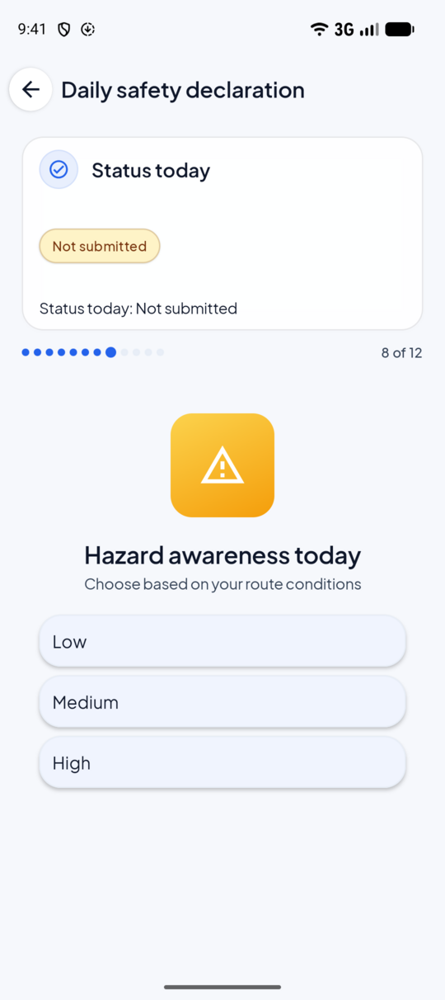
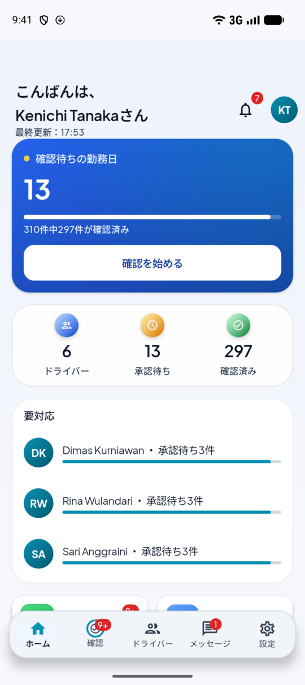
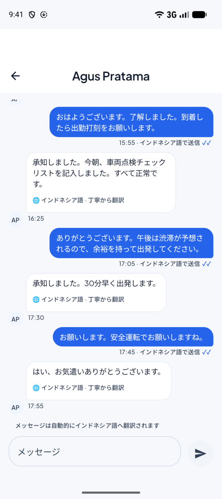
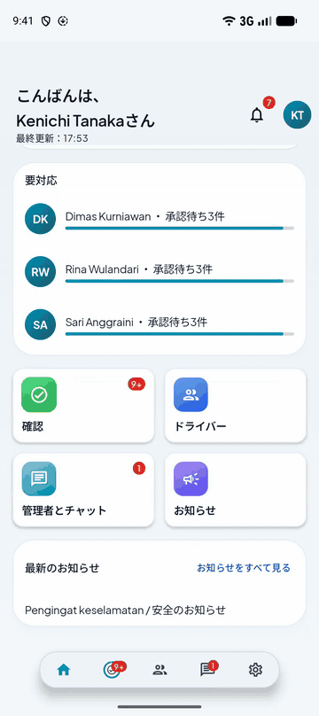
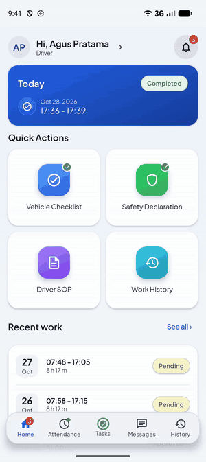
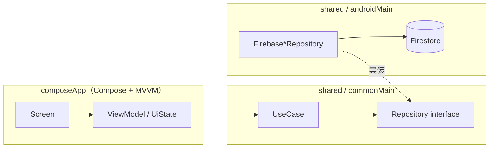
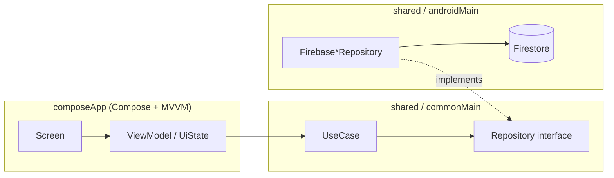

<div align="center">

# DriveMate（ショーケース / Showcase）

**ドライバーと日本人駐在員をつなぐ業務アプリ** ｜ A work app that connects drivers and Japanese expatriates

Kotlin Multiplatform ・ Jetpack Compose ・ MVVM + Clean Architecture ・ Firebase

[日本語](#日本語) ・ [English](#english) ・ [マイルストーン / Milestones](docs/milestones.md) ・ [アーキテクチャ / Architecture](docs/architecture.md)

</div>

---

<a id="日本語"></a>

## 日本語

> **個人開発プロジェクト**です。画面・データ・メッセージはすべて **デモデータ（架空）** です。
> 実在の人物・場所・企業とは関係ありません。

### 解決する課題

- 現場のドライバー（インドネシア語）と日本人駐在員（日本語）は、**言葉の違い**から日々の連絡や確認に手間と誤解が生じがちです。
- 出退勤・車両点検・安全申告といった **毎日の定型業務** を、迷わず、抜け漏れなく終えられる画面が必要です。

### 主な特長

- **端末の言語に自動追従**：日本語／インドネシア語／英語。既定では端末の設定に従います（アプリ内設定は「システムに従う」）。
- **チャット自動翻訳でドライバーと駐在員をつなぐ**：互いの母語で書き、読み手の言語で表示されます（「翻訳元・丁寧さ」も表示）。
  ※ デモでは翻訳を **あらかじめ保存**しています（ライブ翻訳ではありません）。
- **日本の職場文化を意識した UI/UX**：
  - 1 日の流れを一本道に（出勤打刻 → 車両点検 → 安全申告 → 退勤）。**未／済が常に見える**（見える化）。
  - 点検・安全申告は **1 日 1 回**。二重送信はドキュメント ID と Security Rules で防ぎます。
  - 短い文言、大きめのボタン、色と文字による状態の二重表現。派手さより **見やすさと安定性** を優先。

### 画面とデモ（デモデータ）

<table>
  <tr>
    <td align="center"><br>ドライバー：ホーム</td>
    <td align="center"><br>車両点検</td>
    <td align="center"><br>安全申告（12 ステップ）</td>
    <td align="center"><br>駐在員：ホーム（日本語）</td>
    <td align="center"><br>駐在員：チャット（自動翻訳）</td>
  </tr>
</table>

<table>
  <tr>
    <td align="center"><br>1 日の流れ<br>（ログイン → 出勤 → 点検 → 退勤）</td>
    <td align="center"><br>駐在員の画面：<br>インドネシア語のメッセージが日本語に</td>
    <td align="center"><br>端末の言語を変えると<br>アプリも追従</td>
  </tr>
</table>

すべての画像・動画は **エミュレータ上のデモデータ**を撮影したものです（位置情報は公共のランドマークの疑似位置）。

### アーキテクチャ

**プレゼンテーション → ドメイン ← データ** の一方向依存。詳細は [`docs/architecture.md`](docs/architecture.md)。



規則は文章だけでなく、**スクリプトで検査**しています（`./scripts/check-architecture.sh`）。

### 技術スタック

| 領域 | 内容 |
|---|---|
| 言語・共有 | Kotlin 2.4.20、Kotlin Multiplatform（共有：ドメイン＋データ）、Coroutines 1.11.0 |
| Android | Jetpack Compose（BOM 2026.09.00）、Material 3、Navigation Compose 2.9.7、AGP 9.4.1（minSdk 26 / compileSdk 37） |
| DI | Koin 4.2.2（ViewModel はコンストラクタ注入） |
| バックエンド | Firebase（Auth・Firestore・Cloud Messaging）、Cloud Functions（TypeScript・Node 24） |
| テスト | kotlin.test / JUnit、Jest（バックエンド）、Firebase Emulator（ルール） |

### 動かし方（エミュレータ）

実際の Firebase には接続しません。**エミュレータ専用の `demo-drivemate` プロジェクト**を使います。

前提：JDK 17、Android Studio（または Android SDK）、Node 24、`firebase-tools`、エミュレータ用の Java 21。

```bash
./scripts/emulators.sh                      # 1) Auth + Firestore エミュレータを起動
./scripts/seed.sh                           # 2) 別ターミナルでデモデータを投入（何度でも実行可）
cp composeApp/google-services.json.example composeApp/google-services.json   # 3) ダミー設定（秘密情報なし）
cp local.properties.example local.properties
./gradlew :composeApp:installDebug          #    Android エミュレータ（API 26 以上）へインストール
```

ログイン（パスワードはすべて `Demo-Pass-1234`）：`driver@example.com`（ドライバー）／`expat@example.com`（駐在員）／
`driver.new@example.com`（履歴なし・SOP 未承諾の新人）。

### テスト

```bash
./scripts/check-architecture.sh
./gradlew :shared:allTests :composeApp:testDebugUnitTest
npm --prefix backend/functions ci && npm --prefix backend/functions test      # ユニットテスト（エミュレータ不要）
npm --prefix backend/functions run test:rules                                   # Security Rules（Firestore エミュレータ・Java 21 が必要）
```

実測値（2026年10月28日）：`shared` **539 件**、`composeApp` ユニット **302 件**、バックエンドのユニット **69 件**、Security Rules **407 件**（22 スイート）。いずれも失敗 0。
Compose UI・iOS の自動テストは薄く、カバレッジ率は **未計測**です。

### 現状と制限（正直に）

- **含まれないもの**：管理者（Admin）画面（UI が開発中）、iOS アプリ（SwiftUI。**Android より範囲が狭い**ため、同等とは言えません）、
  勤務日生成の Cloud Functions（デモでは履歴をシード）。
  共有モジュールの Kotlin は iOS ターゲット（`iosArm64`・`iosSimulatorArm64`）でコンパイルが通ることを Linux 上で確認しました。
  Swift／Xcode でのビルドは **未検証** です。
- 駐在員は **ホームとメッセージのみ**を収録。承認ワークフローは含みません。
- チャットの翻訳は **デモでは事前保存**。ライブ翻訳には外部 LLM の API キーが必要です。
- 動作確認は **エミュレータ**（API 37）で行いました。このビルドの実機検証は未実施です。
- CI（GitHub Actions）は用意済みですが、**公開後の初回実行の結果は未確認**です（結果が出たら [マイルストーン](docs/milestones.md) に追記します）。
- ログイン失敗の分類がエラーメッセージ文字列に依存している（型付きエラーへの移行は M8 で予定）。
- コード内コメントとテスト名の一部はインドネシア語です。

### ロードマップ

[`docs/milestones.md`](docs/milestones.md)（日本語・English）に、完了条件と証跡つきの工程表があります。

### ライセンス

[MIT](LICENSE)。フォントなどの第三者ライセンスは [`licenses/`](licenses/THIRD_PARTY_NOTICES.md) を参照してください。

### 作者

**Iskandar Jajuri**（[@iskandarjajuri](https://github.com/iskandarjajuri)）— KMP・SwiftUI・Jetpack Compose でアプリを一人で作るエンジニア。
インドネシアから、日本で働くことを目指しています。
[LinkedIn](https://www.linkedin.com/in/iskandar-jajuri/) ・ [Qiita](https://qiita.com/iskandar) ・ [note](https://note.com/iskandar_dev)

---

<a id="english"></a>

## English

> A **personal project**. Every screen, record and message is **demo data (fictional)**, unrelated to any real person,
> place or company.

### The problem

- Drivers on site (Indonesian speakers) and Japanese expatriates (Japanese speakers) lose time and clarity to the
  **language gap** in daily coordination.
- The **daily routine** — clock in/out, vehicle inspection, safety declaration — needs screens that are hard to get
  wrong and hard to forget.

### Highlights

- **Follows the device language** (Japanese / Indonesian / English). By default it follows the device (the in-app
  setting starts at "Follow system").
- **Chat with automatic translation** between drivers and expatriates: each writes in their own language and reads in
  their own, with the source language and politeness shown. *In this demo the translations are pre-seeded; it is not
  live translation.*
- **UI/UX shaped by Japanese workplace expectations:**
  - The day is one straight path (clock in → vehicle checklist → safety declaration → clock out); **done / not done is
    always visible**.
  - The checklist and safety declaration are **once per day**; a second submission is prevented by the document id and
    the Security Rules.
  - Short wording, large buttons, state shown by both colour and text — clarity and stability over flash.

### Screens and demo (demo data)

<table>
  <tr>
    <td align="center"><br>Driver: Home</td>
    <td align="center"><br>Vehicle checklist</td>
    <td align="center"><br>Safety declaration (12 steps)</td>
    <td align="center"><br>Expatriate: Home (Japanese)</td>
    <td align="center"><br>Expatriate: chat (auto-translated)</td>
  </tr>
</table>

<table>
  <tr>
    <td align="center"><br>The driver's day<br>(sign in → clock in → checklist → clock out)</td>
    <td align="center"><br>Expatriate's view:<br>Indonesian messages shown in Japanese</td>
    <td align="center"><br>Change the device language<br>and the app follows</td>
  </tr>
</table>

All images and videos were recorded from **demo data on an emulator** (locations are mock GPS fixes at a public landmark).

### Architecture

One-way dependencies: **presentation → domain ← data**. Details in [`docs/architecture.md`](docs/architecture.md).



The rules are **checked by a script**, not only described (`./scripts/check-architecture.sh`).

### Tech stack

| Area | Details |
|---|---|
| Language / shared | Kotlin 2.4.20, Kotlin Multiplatform (shared: domain + data), Coroutines 1.11.0 |
| Android | Jetpack Compose (BOM 2026.09.00), Material 3, Navigation Compose 2.9.7, AGP 9.4.1 (minSdk 26 / compileSdk 37) |
| DI | Koin 4.2.2 (ViewModels use constructor injection) |
| Backend | Firebase (Auth, Firestore, Cloud Messaging), Cloud Functions (TypeScript, Node 24) |
| Tests | kotlin.test / JUnit, Jest (backend), Firebase Emulator (rules) |

### Run it (emulators)

It never connects to a real Firebase project. It uses an **emulator-only `demo-drivemate` project**.

Prerequisites: JDK 17, Android Studio (or the Android SDK), Node 24, `firebase-tools`, Java 21 for the emulators.

```bash
./scripts/emulators.sh                      # 1) start the Auth + Firestore emulators
./scripts/seed.sh                           # 2) in another terminal: load demo data (re-runnable)
cp composeApp/google-services.json.example composeApp/google-services.json   # 3) placeholder config, no secrets
cp local.properties.example local.properties
./gradlew :composeApp:installDebug          #    install on an Android emulator (API 26+)
```

Sign-ins (every password is `Demo-Pass-1234`): `driver@example.com` (driver), `expat@example.com` (expatriate),
`driver.new@example.com` (a newcomer with no history and the SOP not yet accepted).

### Tests

```bash
./scripts/check-architecture.sh
./gradlew :shared:allTests :composeApp:testDebugUnitTest
npm --prefix backend/functions ci && npm --prefix backend/functions test      # unit tests (no emulator)
npm --prefix backend/functions run test:rules                                   # Security Rules (Firestore emulator; needs Java 21)
```

Measured on 28 October 2026: **539** `shared` tests, **302** `composeApp` unit tests, **69** backend unit tests and
**407** Security Rules tests (22 suites) — all passing. Automated tests for Compose UI and iOS are thin, and the coverage percentage is **not measured**.

### Status and limits (honestly)

- **Not included:** the admin screens (UI still in development), the iOS app (SwiftUI; **narrower than Android**, so claiming
  parity would be wrong), and the workday-generation Cloud Functions (the demo seeds the history instead).
  The shared module's Kotlin compiles for the iOS targets (`iosArm64`, `iosSimulatorArm64`) — verified on Linux. A
  Swift/Xcode build is **not verified**.
- The expatriate role covers **Home and Messages only**; the approval workflow is not included.
- Chat translations are **pre-seeded in the demo**. Live translation needs an external LLM API key.
- Everything was verified on an **emulator** (API 37). This build has not been verified on a physical device.
- A CI workflow (GitHub Actions) is provided, but **the result of its first run after publication is not yet known**
  (it will be added to the [milestones](docs/milestones.md) once it has run).
- Login-failure classification depends on error-message text (moving to typed errors is planned in M8).
- Some code comments and test names are in Indonesian.

### Roadmap

[`docs/milestones.md`](docs/milestones.md) (Japanese and English) has the schedule with a definition of done and evidence
for each milestone.

### License

[MIT](LICENSE). Third-party licences (e.g. the font) are in [`licenses/`](licenses/THIRD_PARTY_NOTICES.md).

### Author

**Iskandar Jajuri** ([@iskandarjajuri](https://github.com/iskandarjajuri)) — a mobile and full-stack engineer who builds apps
end to end with KMP, SwiftUI and Jetpack Compose, in Indonesia and working toward a career in Japan.
[LinkedIn](https://www.linkedin.com/in/iskandar-jajuri/) ・ [Qiita](https://qiita.com/iskandar) ・ [note](https://note.com/iskandar_dev)
