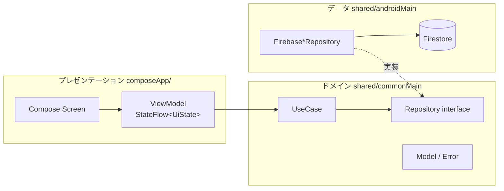
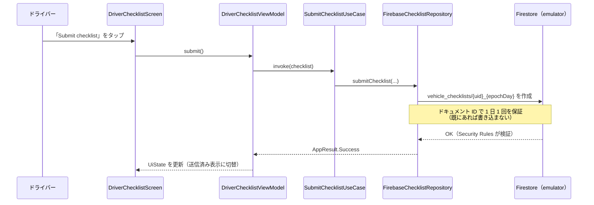
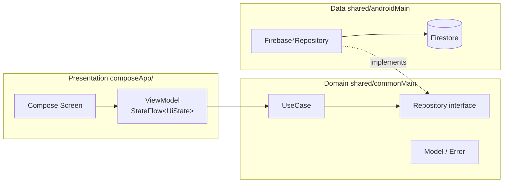
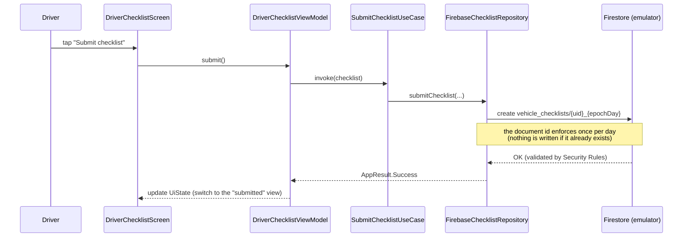

# アーキテクチャ / Architecture

[日本語](#日本語) ・ [English](#english)　｜　[← README](../README.md) ・ [マイルストーン / Milestones](milestones.md)

---

## 日本語

DriveMate は **Kotlin Multiplatform（KMP）の共有モジュール** と **Android（Jetpack Compose）アプリ** からなり、
**MVVM + Clean Architecture** で構成されています。個人開発プロジェクトです。

### 1. レイヤーと依存の向き

依存は一方向です：**プレゼンテーション → ドメイン ← データ**。ドメインはどこにも依存しません。

| レイヤー | 場所 | 責務 |
|---|---|---|
| プレゼンテーション | `composeApp/…/feature/<role>/` | 画面（Compose）、`ViewModel`、`UiState`。状態の変換のみを担当 |
| ドメイン | `shared/src/commonMain/…/domain/`、`core/model/` | ユースケース、リポジトリのインターフェース、モデル、エラー型 |
| データ | `shared/src/androidMain/…/data/repository/` | Firestore を使ったリポジトリ実装。SDK はここだけで使用 |
| DI | Koin（`commonModule`・`AndroidSharedModule`・`androidModule`） | 依存の組み立て。ViewModel は Koin のコンストラクタ注入 |

### 2. 1 つの機能の流れ：日次の車両点検を送信する

- 結果は `AppResult<T>`（`Success` / `Failure`）で返し、**例外をレイヤー境界の外へ投げません**。
- 日付（`epochDay`）は **Asia/Jakarta** を唯一の基準にしています。
- 「1 日 1 回」は UI の無効化だけでなく、ドキュメント ID（`{uid}_{epochDay}`）と Security Rules の両方で担保します。

### 3. 規則を「実行で」確かめる

規則は文章だけでなく、スクリプトで検査します（[`scripts/check-architecture.sh`](../scripts/check-architecture.sh)）：

- `shared/commonMain` は `android.*`・`androidx.*`・`platform.*`・Firebase SDK を import しない
- ViewModel は Firebase SDK を import しない／UI・DI から Firestore・Auth を直接呼ばない
- 本番コードに `GlobalScope`・`runBlocking` を使わない／`commonMain` に `Dispatchers` を直書きしない

### 4. このショーケースに含まれないもの（正直に）

- **管理者（Admin）画面**：UI が開発中のため含めていません。Admin ロールでログインした場合は自動でサインアウトします。
  共有ドメインには管理者向けのユースケースが残っていますが、画面からは使いません。
- **iOS アプリ（SwiftUI）**：本リポジトリには含めていません。現状は Android より範囲が狭く、
  同等の機能が揃っているとは言えないためです（[マイルストーン](milestones.md) の M7 を参照）。
  共有モジュールの Kotlin は iOS ターゲットでコンパイルできます（Linux で確認）。Swift／Xcode のビルドは未検証です。
- **勤務日（workday）生成の Cloud Functions**：含めていません。デモでは履歴データをシードしています。
- **チャット翻訳**：翻訳パイプライン（Cloud Function）は `backend/functions` に含まれますが、外部 LLM の API キーが必要です。
  デモでは、メッセージの原文と翻訳を **あらかじめ Firestore に保存**しています（ライブ翻訳ではありません）。

---

## English

DriveMate is a **Kotlin Multiplatform (KMP) shared module** plus an **Android (Jetpack Compose) app**, structured as
**MVVM + Clean Architecture**. It is a personal project.

### 1. Layers and the direction of dependencies

Dependencies point one way: **presentation → domain ← data**. The domain depends on nothing.

| Layer | Location | Responsibility |
|---|---|---|
| Presentation | `composeApp/…/feature/<role>/` | Compose screens, `ViewModel`, `UiState` — state transformation only |
| Domain | `shared/src/commonMain/…/domain/`, `core/model/` | Use cases, repository interfaces, models, error types |
| Data | `shared/src/androidMain/…/data/repository/` | Firestore-backed repository implementations — the only place the SDK is used |
| DI | Koin (`commonModule`, `AndroidSharedModule`, `androidModule`) | Wiring; ViewModels get their dependencies through the constructor |

### 2. One feature end to end: submitting the daily vehicle checklist

- Results travel as `AppResult<T>` (`Success` / `Failure`); **exceptions never cross a layer boundary**.
- Dates (`epochDay`) use **Asia/Jakarta** as the single source of truth.
- "Once per day" is not just a disabled button: it is enforced by the document id (`{uid}_{epochDay}`) **and** by the Security Rules.

### 3. Rules that are checked by running something

The rules are verified by a script, not only described ([`scripts/check-architecture.sh`](../scripts/check-architecture.sh)):

- `shared/commonMain` never imports `android.*`, `androidx.*`, `platform.*` or the Firebase SDK
- ViewModels never import the Firebase SDK; UI/DI code never calls Firestore or Auth directly
- no `GlobalScope` / `runBlocking` in production code; no hardcoded `Dispatchers` in `commonMain`

### 4. What this showcase does not include (honestly)

- **Admin screens** — the UI is still in development, so it is left out. An Admin login is signed out automatically.
  The shared domain still contains admin-oriented use cases; no screen uses them here.
- **The iOS app (SwiftUI)** — not included. Its scope is currently narrower than Android's, so claiming parity
  would be wrong (see M7 in the [milestones](milestones.md)). The shared module's Kotlin compiles for the iOS targets
  (verified on Linux); a Swift/Xcode build is not verified.
- **The workday-generation Cloud Functions** — not included. The demo seeds the history data instead.
- **Chat translation** — the translation pipeline (a Cloud Function) is included in `backend/functions`, but it needs an
  external LLM API key. In the demo, both the original text and the translation of each message are **pre-seeded in
  Firestore** (this is not live translation).
